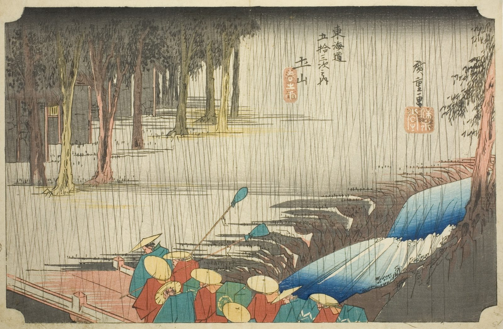

::: {.trail}
[[places|The Road]] / [[Shiga & Kyoto]] / Tsuchiyama
:::

*Utagawa Hiroshige, 1833–34, colour woodblock. [Full size](../assets/aic-25772.jpg)*

> Travelers cross a bridge over a swollen mountain stream at Tsuchiyama in a sudden spring downpour.

### Where it falls on the road

::: {.ruler}
110.3 ri, about 433 km from Nihonbashi.
:::

### Rain, snow and mist

<!-- generated:weather -->
:::grid 3 {.weather .weather-strip}
[[Oiso|Rain]]
+++
[[Mishima|Mist]]
+++
[[Kanbara|Snow]]
+++
[[Shono|Driving rain]]
+++
[[Kameyama|Snow, clearing]]
+++
**Spring shower**  
This print
:::
<!-- /generated:weather -->

::: {.credit}
Art Institute of Chicago · Public domain (CC0) · [Source record](https://www.artic.edu/artworks/25772)
:::
