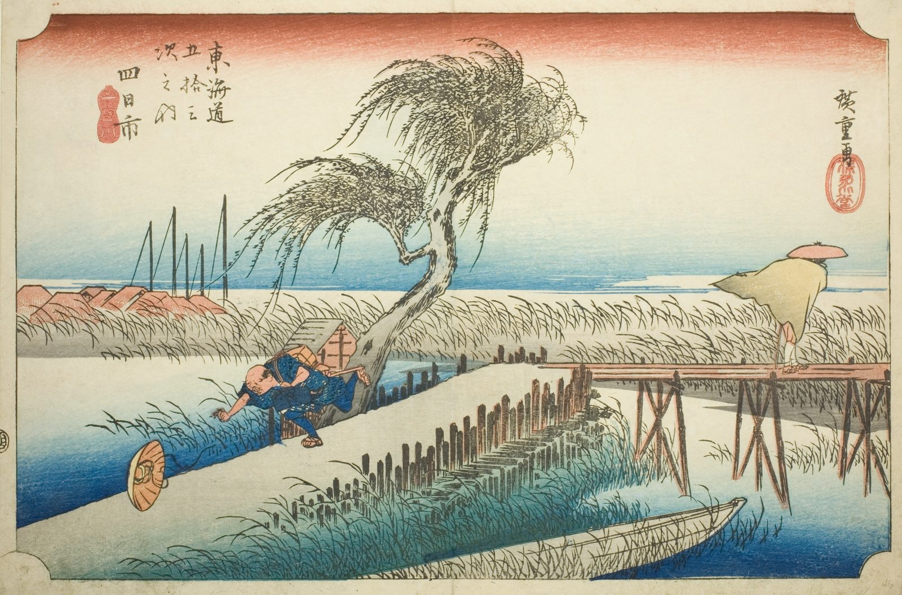

::: {.trail}
[[places|The Road]] / [[Mie]] / Yokkaichi
:::

*Utagawa Hiroshige, 1833–34, colour woodblock. [Full size](../assets/aic-25755.jpg)*

> A traveler's straw hat blows away in the wind as he crosses a plank bridge over the Mie River outside Yokkaichi.

### Where it falls on the road

::: {.ruler}
99.2 ri, about 390 km from Nihonbashi.
:::

::: {.credit}
Art Institute of Chicago · Public domain (CC0) · [Source record](https://www.artic.edu/artworks/25755)
:::
