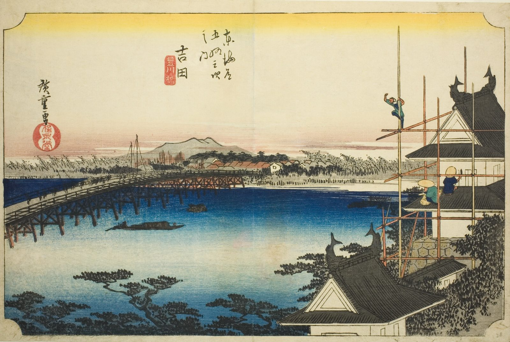

::: {.trail}
[[places|The Road]] / [[Aichi]] / Yoshida
:::

*Utagawa Hiroshige, 1833–34, colour woodblock. [Full size](../assets/aic-59092.jpg)*

> Workers repair the long wooden bridge over the Toyo River at Yoshida beneath the walls of Yoshida Castle.

### Where it falls on the road

::: {.ruler}
73.7 ri, about 289 km from Nihonbashi.
:::

::: {.credit}
Art Institute of Chicago · Public domain (CC0) · [Source record](https://www.artic.edu/artworks/59092)
:::
