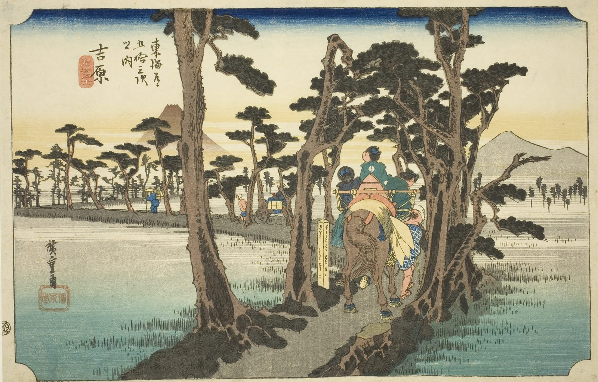

::: {.trail}
[[places|The Road]] / [[Shizuoka]] / Yoshiwara
:::

*Utagawa Hiroshige, 1833–34, colour woodblock. [Full size](../assets/aic-10929.jpg)*

::: {.eyebrow}
Station 14 · Fuji, Shizuoka
:::

::: {.numeral}
14

of 53
:::

::: {.slip}
吉原
:::

::: {.subtitle}
*Yoshiwara, hidari Fuji*
:::

> Riders and porters follow a bend in the road at Yoshiwara from which Mount Fuji unusually appears on the left side of the frame.

### Where it falls on the road

::: {.ruler}
34.8 ri, about 137 km from Nihonbashi.
:::

::: {.credit}
Art Institute of Chicago · Public domain (CC0) · [Source record](https://www.artic.edu/artworks/10929)
:::
