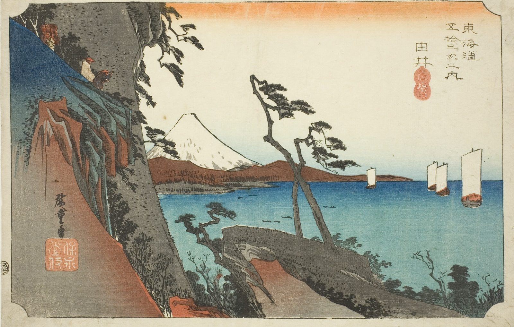

::: {.trail}
[[places|The Road]] / [[Shizuoka]] / Yui
:::

*Utagawa Hiroshige, 1833–34, colour woodblock. [Full size](../assets/aic-18255.jpg)*

> Travelers pause on the cliffside Satta Pass trail overlooking Suruga Bay, with Mount Fuji visible across the water.

### Where it falls on the road

::: {.ruler}
38.6 ri, about 152 km from Nihonbashi.
:::

::: {.credit}
Art Institute of Chicago · Public domain (CC0) · [Source record](https://www.artic.edu/artworks/18255)
:::
