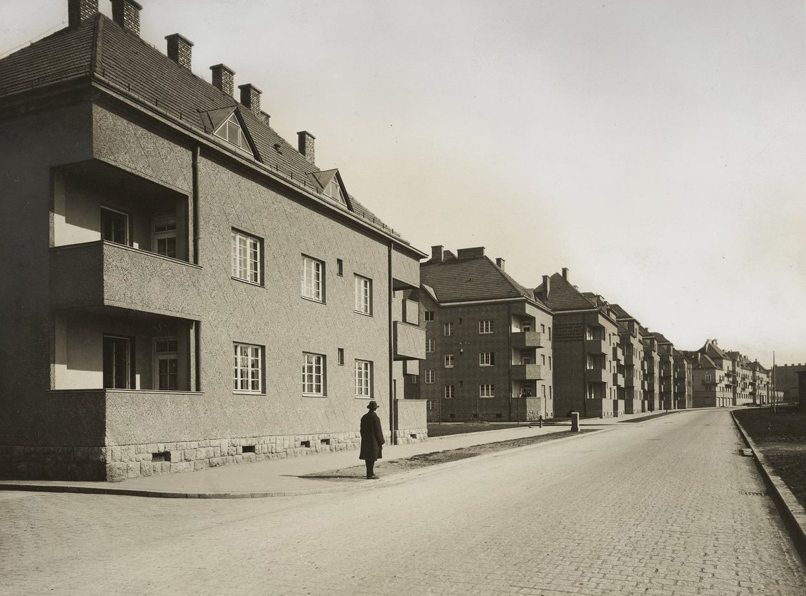

A garden estate in Favoriten built 1927–1930, to designs by Karl Krist and Robert Oerley.

:::gallery rows

*The George-Washington-Hof under construction, Triester Straße 52–58; the mount is inscribed “Spinnerin am Kreuz”, the name of the neighbourhood. Photographer unknown, around 1930. Wien Museum, inv. 56559/1, CC0.*

*A view of the George-Washington-Hof from Triester Straße. Paul Frankenstein and Maximilian Frankenstein, around 1930. Wien Museum, inv. 67669/1, CC0.*

*A second view of the George-Washington-Hof from Triester Straße. Paul Frankenstein and Maximilian Frankenstein, around 1930. Wien Museum, inv. 67669/2, CC0.*
:::

## Sources

- [George-Washington-Hof](https://de.wikipedia.org/wiki/George-Washington-Hof), Wikipedia (de), checked 14 October 2026
