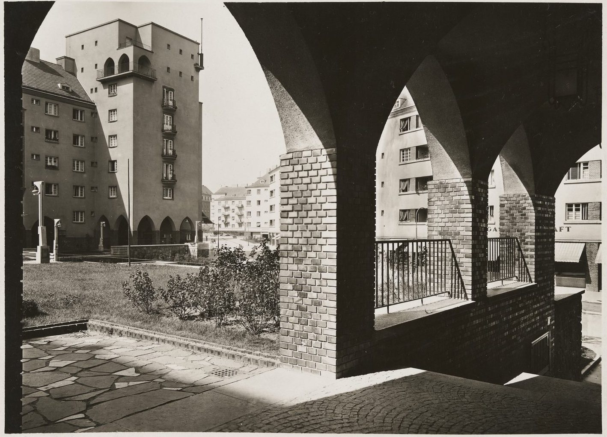

A block in Landstraße, built 1925–1928; a renovation later made 1,138 units out of the original 1,100.

## Sources

- [Rabenhof (Wien)](https://de.wikipedia.org/wiki/Rabenhof_(Wien)), Wikipedia (de), checked 14 October 2026
