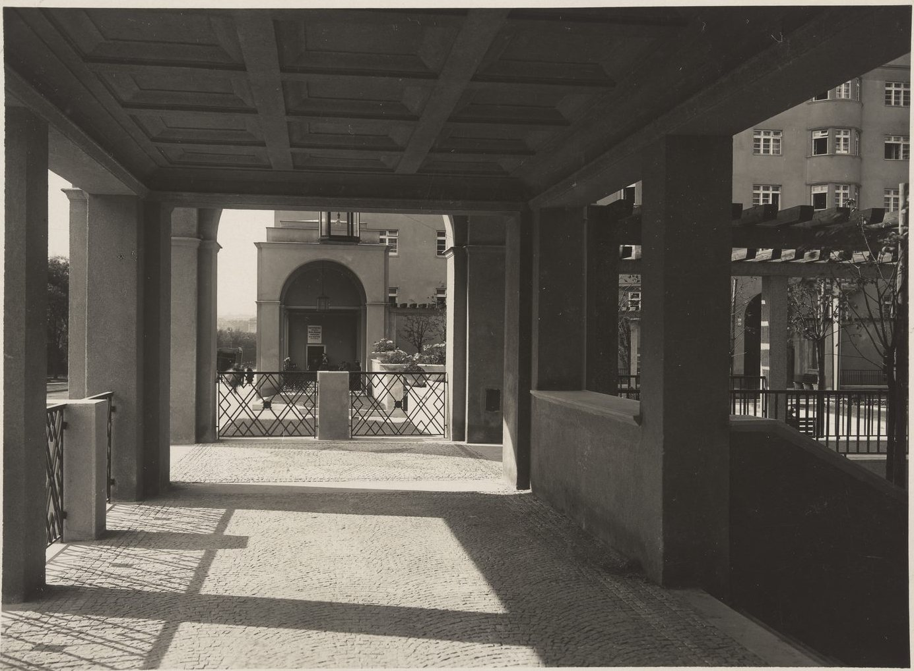

A block on the Margaretengürtel, built 1924–1926.

:::grid 4 {.pictures-set}

+++

+++

+++

:::

## Sources

- [Reumannhof](https://de.wikipedia.org/wiki/Reumannhof), Wikipedia (de), checked 14 October 2026
