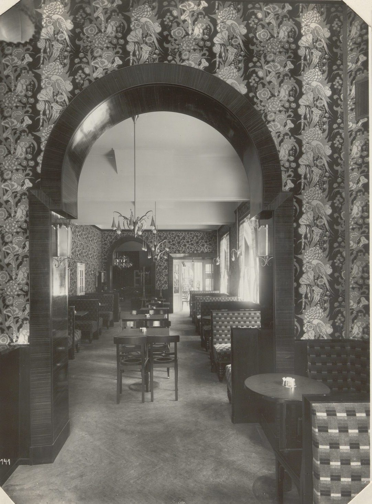

The largest estate on this board by number of flats, in Ottakring, with a café of its own (pictured).

:::gallery rows

*Sandleiten estate in Ottakring, seen from Matteottiplatz at Sandleitengasse 43–51. Martin Gerlach jun., around 1930. Wien Museum, inv. 59241/974, CC0.*

*The kindergarten of the Sandleiten estate, Rosenackerstraße 5. Martin Gerlach jun., around 1930. Wien Museum, inv. 59161/1513, CC0.*

*The reading room of the library in the Sandleiten estate, Rosa-Luxemburg-Gasse 4. Martin Gerlach jun., around 1930. Wien Museum, inv. 59241/1008, CC0.*

*Spin dryers in the laundry of the Sandleiten estate. Martin Gerlach jun., around 1930. Wien Museum, inv. 59241/994, CC0.*
:::

## Sources

- [Sandleitenhof](https://de.wikipedia.org/wiki/Sandleitenhof), Wikipedia (de), checked 14 October 2026
