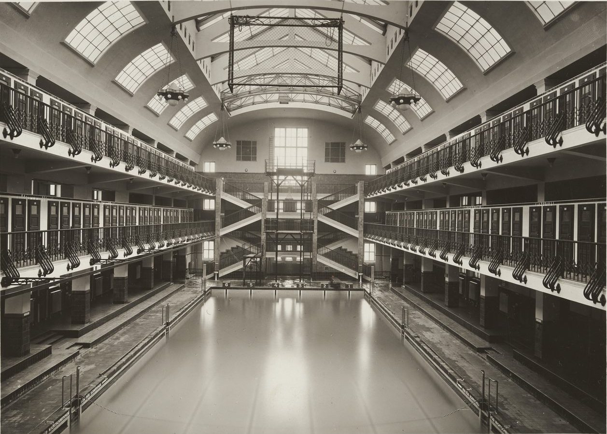

A municipal bath in Favoriten, built 1923–1926.

:::grid 4 {.pictures-set}

+++

+++

+++

:::

## Sources

- [Amalienbad](https://de.wikipedia.org/wiki/Amalienbad), Wikipedia (de), checked 14 October 2026
