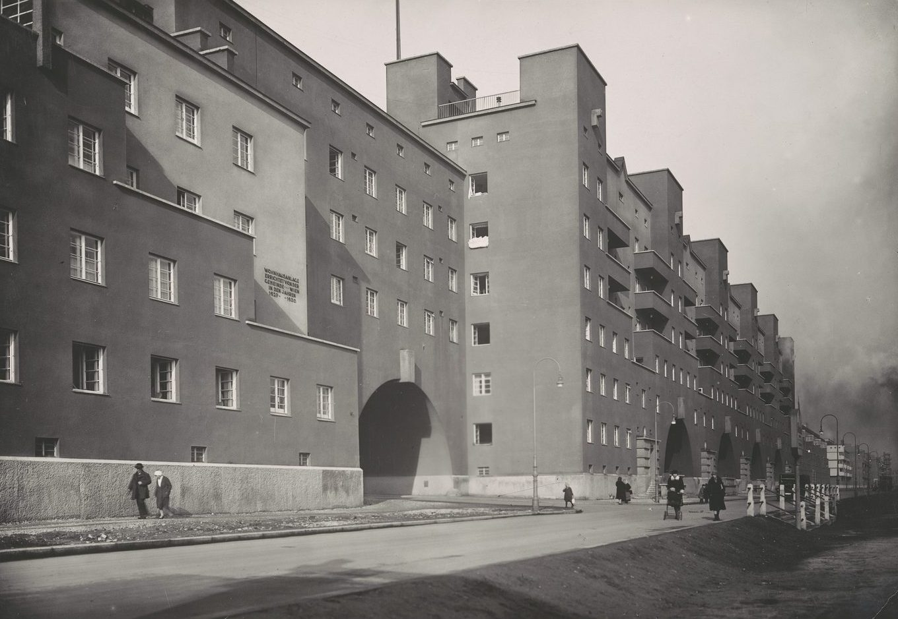

Ein einzelner, rund einen Kilometer langer Baublock in Döbling, von der Stadt errichtet nach Plänen von Karl Ehn, einem Schüler Otto Wagners. Nur 23 Prozent des 150.000 Quadratmeter großen Areals sind bebaut; der Rest sind Höfe und Gärten.

Eröffnet am 12. Oktober 1930.

Die Tafel an der Fassade, auf dem Foto zu sehen, lautet „Wohnhausanlage errichtet von der Gemeinde Wien in den Jahren 19__–1930“ (die erste Jahreszahl ist auf diesem Abzug nicht lesbar). Sie nennt 1930, das Jahr der Eröffnung des Baus; die letzten Abschnitte wurden 1933 fertig.

Die Quellen widersprechen einander: Derselbe Artikel nennt 1.382 Wohnungen für rund 5.000 Bewohner und eine Aufschlüsselung nach Wohnungstypen, die sich auf 1.043 summiert.

Der Hof steht im 19. Bezirk, Döbling, in der Heiligenstädter Straße 82–92.

## Im Inneren des Blocks

- Zwei Kindergärten und eine Mutterberatungsstelle
- Ein Jugendheim und eine Bücherei
- Eine Ambulanz, eine Zahnklinik und eine Apotheke
- Ein Postamt, Geschäfte und eine zentrale Waschküche

## Danach

- Februar 1934: Mitglieder des Republikanischen Schutzbundes hielten den Bau, bis das Bundesheer ihn beschoss
- 1934–1953: zweimal umbenannt; 1953 kehrte der ursprüngliche Name zurück
- 1980er Jahre: umfassende Sanierung

## Quellen

- [Karl-Marx-Hof](https://de.wikipedia.org/wiki/Karl-Marx-Hof), Wikipedia (de), geprüft am 14. Oktober 2026
- [Karl-Marx-Hof, Fassade zum Bahnhof Heiligenstadt, Martin Gerlach jun., um 1930, Inv. 59241/1126](https://sammlung.wienmuseum.at/en/object/133336-19-heiligenstaedter-strasse-82-92-karl-marx-hof-fassade-zum-bahnhof-heiligenstadt/), Wien Museum Online Sammlung, CC0, geprüft am 14. Oktober 2026
